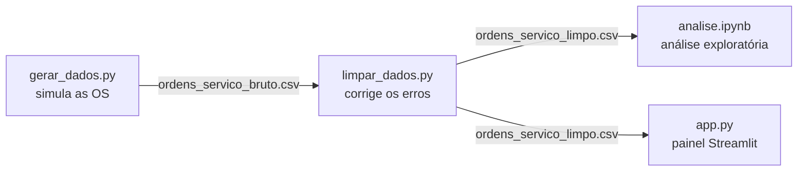
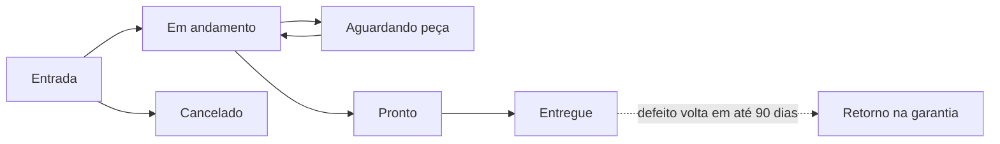

# Painel de BI — Assistência Técnica de Celulares

Solução de Business Intelligence desenvolvida para a **Opção Telefonia Celular**, assistência
técnica e loja de celulares em **Bauru (SP)**. O painel transforma as ordens de serviço da loja
em indicadores, gráficos e recomendações que ajudam o dono a decidir onde melhorar: estoque,
equipe, prazos e qualidade dos reparos.

> **Aviso:** os dados usados neste projeto são **simulados** com base em informações passadas
> pela empresa. Eles não são os dados reais da assistência (veja a [seção 2](#2-problema-e-seleção-dos-dados)).

**Ferramentas:** Python · pandas · NumPy · Plotly · Streamlit · Jupyter · GitHub

---

## Sumário

- [Como rodar](#como-rodar)
- [Visão geral do sistema](#visão-geral-do-sistema)
- [1. Empresa e necessidade](#1-empresa-e-necessidade)
- [2. Problema e seleção dos dados](#2-problema-e-seleção-dos-dados)
- [3. Limpeza, tratamento e exploração](#3-limpeza-tratamento-e-exploração)
- [4. Painel interativo](#4-painel-interativo)
- [5. Insights para a tomada de decisão](#5-insights-para-a-tomada-de-decisão)
- [6. Usabilidade e clareza](#6-usabilidade-e-clareza)
- [Desafios e decisões do projeto](#desafios-e-decisões-do-projeto)
- [Limitações e próximos passos](#limitações-e-próximos-passos)
- [Grupo](#grupo)

---

## Como rodar

Pré-requisito: Python 3.10 ou superior.

```bash
pip install -r requirements.txt   # instala as bibliotecas
python gerar_dados.py             # cria dados/ordens_servico_bruto.csv
python limpar_dados.py            # cria dados/ordens_servico_limpo.csv e mostra o relatório
streamlit run app.py              # abre o painel em http://localhost:8501
```

Os dois CSVs já estão no repositório, então dá para rodar direto o `streamlit run app.py`.
Para ver a análise exploratória, abra o `analise.ipynb` no Jupyter ou no VS Code.

---

## Visão geral do sistema

O projeto é um **pipeline de dados** em quatro etapas. Cada etapa é um arquivo e entrega um
resultado para a próxima:



| Etapa | Arquivo | Entrada | Saída |
|---|---|---|---|
| 1. Coleta (simulada) | `gerar_dados.py` | Parâmetros informados pelo dono | `dados/ordens_servico_bruto.csv` (2.508 linhas, com erros) |
| 2. Limpeza | `limpar_dados.py` | Base bruta | `dados/ordens_servico_limpo.csv` (2.478 linhas) + relatório |
| 3. Exploração | `analise.ipynb` | Base limpa | Gráficos e 5 conclusões |
| 4. Visualização | `app.py` | Base limpa | Painel interativo com filtros, indicadores, gráficos e insights |

### Estrutura de pastas

```
├── README.md                  # este documento
├── requirements.txt           # bibliotecas usadas
├── gerar_dados.py             # etapa 1: cria a base simulada
├── limpar_dados.py            # etapa 2: limpa a base
├── analise.ipynb              # etapa 3: análise exploratória
├── app.py                     # etapa 4: painel Streamlit
├── .streamlit/config.toml     # tema visual do painel
├── dados/
│   ├── ordens_servico_bruto.csv
│   └── ordens_servico_limpo.csv
└── docs/
    └── entrega1.md            # documento da Entrega 1
```

---

## 1. Empresa e necessidade

> *Objetivo: identificar uma empresa real e compreender uma necessidade que possa ser apoiada por BI.*

| | |
|---|---|
| **Empresa** | Opção Telefonia Celular |
| **O que faz** | Assistência técnica (conserto) e venda de celulares |
| **Onde fica** | Bauru (SP) |
| **Responsável** | Felipe Campos Guimarães, dono da empresa e técnico |
| **Equipe técnica** | 2 técnicos: Felipe e Carlos Eduardo |

### Como a loja funciona

Cada celular que chega para conserto gera uma **ordem de serviço (OS)**. A OS passa por estas etapas:



### A necessidade

Em conversa com o dono, identificamos que ele **não tem uma visão clara** do próprio negócio:

- quantos aparelhos entram e saem por mês;
- quanto tempo cada tipo de reparo leva;
- quais defeitos são mais comuns;
- quais consertos voltam na garantia (retrabalho que custa tempo e dinheiro);
- quais serviços trazem mais receita.

Sem esses números, decisões como "quanto estoque de tela manter", "quando reforçar a equipe" ou
"qual serviço precisa de atenção" são tomadas no feeling.

---

## 2. Problema e seleção dos dados

> *Objetivo: definir o problema e escolher dados relacionados à necessidade.*

### O problema

**Como transformar o histórico de ordens de serviço em informação para o dono decidir onde
melhorar?** A resposta é um painel simples, que ele pode abrir e filtrar sozinho.

### Por que dados simulados

A empresa não liberou os dados reais das ordens de serviço. Por isso, criamos uma **base simulada
que imita o comportamento da loja**, usando números passados pelo dono: volume diário, marcas
atendidas, defeitos mais comuns, faixas de preço e prazos. Assim, o painel fica pronto para
receber os dados reais no futuro: basta trocar o CSV.

### Dicionário de dados

Uma linha por OS, 12 meses de dados (01/11/2025 a 17/10/2026), separador `;`.

| Coluna | Descrição | Exemplo |
|---|---|---|
| `os_id` | Número da OS | `OS-0001` |
| `data_entrada` | Quando o aparelho chegou | `2026-03-10` |
| `data_conclusao` | Quando o reparo terminou (vazio se não terminou) | `2026-03-12` |
| `data_entrega` | Quando o cliente retirou (vazio se não retirou) | `2026-03-13` |
| `marca` | Samsung, Apple, Motorola ou Xiaomi | `Samsung` |
| `modelo` | Modelo do aparelho | `Galaxy A54` |
| `defeito` | Problema relatado | `Tela quebrada` |
| `tipo_reparo` | Serviço feito | `Troca de tela` |
| `tecnico` | Quem consertou | `Felipe` |
| `status` | Em andamento, Aguardando peça, Pronto, Entregue ou Cancelado | `Entregue` |
| `valor` | Valor cobrado em R$ | `350.00` |
| `retorno_garantia` | Voltou com defeito em até 90 dias? (só para entregues) | `Sim` / `Não` |

Colunas criadas na limpeza: `dias_reparo` (dias entre entrada e conclusão) e `mes` (mês da entrada, ex.: `2026-03`).

---

## 3. Limpeza, tratamento e exploração

> *Objetivo: pré-processar (limpar, transformar, organizar) e explorar os dados.*

### 3.1 Geração da base — `gerar_dados.py`

O script usa `numpy` para sortear os dados e `pandas` para montar a tabela.
`np.random.seed(42)` garante que a base saia **sempre igual**, então qualquer pessoa que rodar o
script chega nos mesmos números.

Todos os parâmetros ficam **em variáveis no topo do script**. Se o dono passar números
diferentes, é só ajustar ali.

| Parâmetro | Valor usado |
|---|---|
| Volume | ~8 aparelhos/dia, sem domingos; dezembro e janeiro com 30% a mais |
| Marcas | Samsung 40% · Apple 30% · Motorola 20% · Xiaomi 10% (3 a 4 modelos cada) |
| Preço Apple | ~50% mais caro que as outras marcas |
| Técnicos | Felipe e Carlos Eduardo, com a mesma chance de retorno |
| Espera de peça | 15% das trocas de tela e reparos de placa ganham +3 a 7 dias |
| Cancelamentos | ~5% das OS (valor 0, sem conclusão) |

| Defeito | Tipo de reparo | Chance | Preço (R$) | Dias | Chance de retorno |
|---|---|---|---|---|---|
| Tela quebrada | Troca de tela | 35% | 250–700 | 1–3 | 5% |
| Bateria viciada | Troca de bateria | 20% | 120–280 | 1–2 | 4% |
| Conector de carga | Troca de conector | 15% | 90–190 | 1–2 | 8% |
| Não liga | Reparo de placa | 10% | 200–600 | 3–8 | 15% |
| Danos por água | Limpeza de oxidação | 10% | 150–380 | 3–7 | 25% |
| Software travando | Reinstalação de software | 10% | 60–140 | 0–1 | 10% |

**Como o script funciona, passo a passo:**

1. **Datas de entrada:** para cada dia do período (menos domingos), sorteia quantos aparelhos
   chegaram usando `np.random.poisson(média)`, uma distribuição usada para contagens.
2. **Sorteios:** marca, modelo, defeito e técnico são sorteados com `np.random.choice`,
   respeitando as chances da tabela.
3. **Cada OS:** calcula o preço, os dias de reparo (às vezes com espera de peça) e as datas de
   conclusão e entrega.
4. **Status:** compara as datas com o "hoje" da base (17/10/2026). Se o conserto ainda não
   terminou, a OS fica `Em andamento` ou `Aguardando peça`. Se terminou mas o cliente não
   retirou, fica `Pronto`. Se já foi retirada, fica `Entregue`.
5. **Retorno na garantia:** sorteado só para OS entregues, com a chance do defeito.
6. **Erros de propósito:** a base é "suja" antes de salvar, para simular problemas reais de
   digitação:

| Erro inserido | Quantidade | Exemplo |
|---|---|---|
| Datas no formato brasileiro | ~10% de cada coluna de data | `03/06/2026` em vez de `2026-06-03` |
| Marcas escritas errado | ~8% | `samsung`, `SAMSUNG`, `Sansung`, `apple`, `iPhone`, `moto`, `XIAOMI` |
| Valores como texto | ~10% | `R$ 350,00` em vez de `350.00` |
| Técnico vazio | ~3% | campo em branco |
| Linhas duplicadas | 30 | mesma OS digitada duas vezes |

### 3.2 Limpeza — `limpar_dados.py`

Cada problema é corrigido por **uma função pequena**. Todas seguem o mesmo padrão: recebem a
tabela e devolvem `(tabela corrigida, quantidade de linhas corrigidas)`. Isso permite montar o
relatório no final.

| Função | O que faz | Como faz |
|---|---|---|
| `remover_duplicadas` | Remove linhas repetidas | `df.drop_duplicates()` |
| `corrigir_datas` | Converte as 3 colunas de data | Tenta ler como `AAAA-MM-DD`; o que falhar, tenta como `DD/MM/AAAA` |
| `padronizar_marcas` | Unifica a escrita das marcas | Tira espaços, passa para minúsculas e aplica um dicionário de correções (`sansung` → Samsung, `iphone` → Apple, `moto` → Motorola) |
| `converter_valores` | Transforma texto em número | Remove `R$`, troca vírgula por ponto e converte para `float` |
| `preencher_tecnico` | Trata técnico vazio | Preenche com `Não informado` (não inventa quem fez o reparo) |
| `criar_colunas` | Cria colunas úteis para a análise | `dias_reparo` = conclusão − entrada; `mes` = mês da entrada |

A base bruta é lida com `dtype=str` (tudo como texto), para que o pandas não tente adivinhar os
tipos e cada função trate sua coluna do jeito certo.

**Relatório gerado ao rodar `python limpar_dados.py`:**

```
=== Relatório de limpeza ===
Linhas na base bruta:          2508
Duplicadas removidas:          30
Linhas com data DD/MM/AAAA:    621
Marcas padronizadas:           209
Valores em texto convertidos:  244
Técnicos vazios preenchidos:   71
Colunas criadas:               dias_reparo, mes
Linhas na base limpa:          2478
```

Depois da limpeza: nenhuma duplicada, todas as marcas dentro da lista oficial, coluna `valor`
numérica e nenhuma data perdida (só ficam vazias as datas que ainda não aconteceram).

### 3.3 Análise exploratória — `analise.ipynb`

O notebook usa a base limpa e tem uma seção por pergunta. Cada seção tem um gráfico Plotly e
um texto curto explicando o que ele mostra.

| Seção | Pergunta | O que encontramos |
|---|---|---|
| 1. Visão geral | Como é a base? | 2.478 OS; 94% entregues, 5% canceladas |
| 2. Recebidos por mês | Existe época de pico? | Dezembro e janeiro têm ~29% mais entradas |
| 3. Defeitos | Qual o problema mais comum? | Tela quebrada (35,6% das OS) |
| 4. Tempo de reparo | Qual serviço demora mais? | Reparo de placa (6,2 dias em média) |
| 5. Retorno na garantia | O que mais volta? | Danos por água (24% de retorno) |
| 6. Receita | O que dá mais dinheiro? | Troca de tela (55,9% da receita) |
| 7. Conclusões | — | 5 descobertas, cada uma com o número que a comprova |

---

## 4. Painel interativo

> *Objetivo: criar visualizações e relatórios que permitam explorar os dados de forma clara e interativa.*

O painel é um único arquivo, `app.py`, feito com **Streamlit** (gera a página web a partir de
Python) e **Plotly** (gráficos interativos, com zoom e valores ao passar o mouse).

### Layout

```
┌──────────────┬───────────────────────────────────────────────────────┐
│  FILTROS     │  Painel da Assistência Técnica                        │
│              │  ┌─────────┐┌─────────┐┌─────────┐┌─────────┐         │
│  Período     │  │Recebidos││Entregues││Andamento││Tempo méd│         │
│  Marca       │  └─────────┘└─────────┘└─────────┘└─────────┘         │
│  Técnico     │  ┌─────────┐┌─────────┐┌─────────┐┌─────────┐         │
│              │  │Conclusão││Retorno  ││Receita  ││Ticket   │         │
│  Nota: dados │  └─────────┘└─────────┘└─────────┘└─────────┘         │
│  simulados   │  [Visão geral][Serviços][Qualidade][Financeiro][Dados]│
│              │  gráficos da aba selecionada                          │
└──────────────┴───────────────────────────────────────────────────────┘
```

### Como o código funciona, bloco a bloco

**1. Carregamento com cache.** A função `carregar_dados()` lê o CSV limpo e converte as datas.
O decorador `@st.cache_data` guarda o resultado na memória: o Streamlit roda o script inteiro a
cada clique, mas o arquivo só é lido uma vez.

**2. Filtros na barra lateral.**
- **Período** (`st.date_input`): intervalo de datas de entrada.
- **Marca** e **Técnico** (`st.multiselect`): deixar vazio significa "todos".

O código cria duas tabelas filtradas:
- `base`: filtrada só por marca e técnico;
- `filtrado`: `base` + filtro de período pela data de entrada.

Essa separação existe porque alguns indicadores contam por **outra data** (veja abaixo).

**3. Indicadores (cartões no topo).** Os 8 indicadores seguem estas regras:

| Indicador | Cálculo | Tabela usada |
|---|---|---|
| Aparelhos recebidos | Quantidade de OS | `filtrado` (data de entrada no período) |
| Aparelhos entregues | OS com status `Entregue` e **data de entrega** no período | `base` |
| Em andamento (hoje) | OS com status `Em andamento` ou `Aguardando peça` | `base` (situação atual, ignora o período) |
| Tempo médio de reparo | Média de `dias_reparo` | `filtrado` |
| Taxa de conclusão | (Pronto + Entregue) ÷ (recebidas − em andamento) | `filtrado` |
| Taxa de retorno | Retornos na garantia ÷ entregues | entregues |
| Receita total | Soma de `valor` das entregues | entregues |
| Ticket médio | Receita ÷ entregues | entregues |

A receita conta pela **data de entrega**, porque é quando o cliente paga. Um aparelho que
entrou em setembro e foi retirado em outubro entra na receita de outubro.

**4. Formatação brasileira.** Três funções pequenas (`formatar_numero`, `formatar_reais`,
`formatar_percentual`) mostram os números como `R$ 1.234,56` e `12,5%`, em vez do formato
americano.

**5. Abas e gráficos.** Todos os gráficos usam os dados já filtrados, então mudam junto com os filtros.

| Aba | Gráficos | Pergunta que responde |
|---|---|---|
| **Visão geral** | Linha: recebidos × entregues por mês + seção de Insights | O movimento está crescendo? A loja dá conta da demanda? |
| **Serviços** | Barras: serviços em andamento por status · Barras: tempo médio por tipo de reparo | O que está parado hoje? O que demora mais? |
| **Qualidade** | Barras: defeitos mais frequentes · Taxa de retorno por defeito e por técnico, com linha tracejada na média | O que mais chega? O que mais volta? |
| **Financeiro** | Barras: receita por tipo de reparo · Linha: receita por mês | O que dá mais dinheiro? Como a receita varia no ano? |
| **Dados** | Tabela com as OS filtradas + botão **Baixar CSV** | Quero ver ou exportar os registros |

Os dois gráficos de retorno usam a mesma função, `grafico_retorno(coluna, titulo)`, que só muda
a coluna agrupada (defeito ou técnico).

**6. Visual.** O tema claro, no estilo de dashboard de BI, fica no `.streamlit/config.toml`:
fundo branco e azul-escuro como cor principal. Os gráficos usam o template `plotly_white` e
uma paleta em tons de azul (lista `CORES` no topo do `app.py`). Cartões e gráficos ficam dentro
de containers com borda, criados pela função `mostrar_grafico`.

---

## 5. Insights para a tomada de decisão

> *Objetivo: apresentar informações que contribuam para decisões, com análises descritivas, diagnósticas, preditivas ou prescritivas.*

O projeto usa três tipos de análise:

| Tipo | O que responde | Onde aparece |
|---|---|---|
| **Descritiva** | *O que aconteceu?* | Cartões, gráficos de volume, defeitos e receita |
| **Diagnóstica** | *Por que aconteceu?* | Retorno por defeito e por técnico comparado com a média; tempo por tipo de reparo; efeito da espera de peça |
| **Prescritiva** | *O que fazer?* | Cada insight termina com uma recomendação (→) |

### Insights automáticos

No fim da aba **Visão geral**, o painel escreve até 5 frases **calculadas na hora** a partir dos
dados filtrados. Nenhum número fica fixo no texto: se o dono filtrar só Apple ou só dezembro, as
frases mudam.

| # | O que o código calcula | Exemplo (sem filtro) | Recomendação |
|---|---|---|---|
| 1 | Tipo de reparo com maior fatia da receita | Troca de tela = **55,9%** da receita | Manter estoque de peças dos modelos mais comuns |
| 2 | Defeito com maior taxa de retorno ÷ média geral | Danos por água volta em **24,0%**, **3,0×** a média | Revisar o procedimento ou o prazo de garantia |
| 3 | Técnico com mais retorno ÷ taxa dos demais | Carlos Eduardo 8,3% · Felipe 7,8% (parecidas) | Os retornos dependem mais do defeito do que de quem conserta |
| 4 | Mês com mais entradas | Dezembro/2025: **281** aparelhos (média 206) | Reforçar a equipe nessa época |
| 5 | Tipo de reparo com maior tempo médio | Reparo de placa: **6,2 dias** (média 2,6) | Avisar o cliente do prazo e manter peças em estoque |

Duas regras evitam conclusões erradas:
- **Mínimo de 30 OS:** com poucos dados, uma única OS vira "100% da receita". Abaixo desse
  número, o painel mostra um aviso no lugar dos insights.
- **Técnicos só são apontados se a diferença for grande** (50% a mais que o outro). Diferenças
  pequenas são tratadas como normais, para não culpar ninguém sem motivo.

### Principais descobertas (dados completos)

1. **Tela quebrada é o carro-chefe:** 35,6% das OS e 55,9% da receita (R$ 454 mil de R$ 813 mil).
2. **Dezembro e janeiro são o pico:** ~29% mais aparelhos que nos outros meses.
3. **Danos por água volta muito:** 24,0% de retorno, contra 8,0% na média geral.
4. **Apple tem o maior ticket:** R$ 465,62 por reparo, ~56% acima das outras marcas, e 41% da receita.
5. **Reparo de placa é o mais demorado:** 6,2 dias em média, contra 0,4 a 2,8 nos reparos simples.

---

## 6. Usabilidade e clareza

> *Objetivo: solução intuitiva, organizada e adequada ao público que vai usar.*

O público do painel é o **dono da loja**, que não é da área de dados. Por isso:

- **Tudo em português**, com termos do dia a dia da loja (aparelhos, reparo, garantia).
- **Números no formato brasileiro:** `R$ 813.414,35` e `8,0%`.
- **Do geral para o detalhe:** primeiro os 8 números principais, depois as abas por assunto,
  e por fim a tabela com os registros.
- **Abas por pergunta de negócio** (Serviços, Qualidade, Financeiro), e não por tipo de gráfico.
- **Títulos que dizem o que o gráfico mostra**, como "Taxa de retorno por defeito".
- **Linha da média** nos gráficos de retorno, para ver na hora quem está acima.
- **Filtros simples:** vazio = todos; o período usa o formato de data brasileiro.
- **Insights em frases com recomendação:** o dono não precisa interpretar o gráfico sozinho.
- **Exportação para CSV** com acentos corretos ao abrir no Excel (`utf-8-sig`).
- **Visual limpo de BI:** fundo branco, cartões com borda, uma paleta só, sem botões de desenvolvedor.
- **Transparência:** a barra lateral avisa que os dados são simulados.

---

## Desafios e decisões do projeto

| Desafio | Como resolvemos |
|---|---|
| A empresa não liberou os dados reais | Base simulada com os números informados pelo dono, com parâmetros fáceis de ajustar |
| Tornar a limpeza realista | A base é gerada com erros comuns de digitação, para a limpeza ter o que corrigir |
| Datas em dois formatos na mesma coluna | Leitura em duas tentativas (`AAAA-MM-DD` e depois `DD/MM/AAAA`) |
| Indicadores contados pela data certa | Recebidos pela data de entrada; entregues e receita pela data de entrega |
| Insights que não enganam com poucos dados | Mínimo de 30 OS e limite de diferença para apontar técnicos |
| Dados simulados com pessoas reais | Os técnicos reais têm a mesma chance de retorno: o painel não inventa diferença de desempenho |
| Painel mostrando dados antigos | O `@st.cache_data` guarda os dados na memória; ao trocar o CSV, é preciso limpar o cache (menu ⋮ → *Clear cache*) ou reiniciar o painel |

---

## Limitações e próximos passos

- **Dados simulados:** os números refletem as informações do dono, não o histórico real. O
  próximo passo é carregar os dados reais da loja. O painel funciona com qualquer CSV no mesmo formato.
- **Análise preditiva:** com dados reais, dá para prever a demanda dos próximos meses e
  planejar o estoque de peças.
- **Custos:** o painel mostra a receita, mas não o custo das peças. Com essa informação, seria
  possível calcular o lucro por tipo de reparo.

---

## Grupo

- Cherlau
- João
