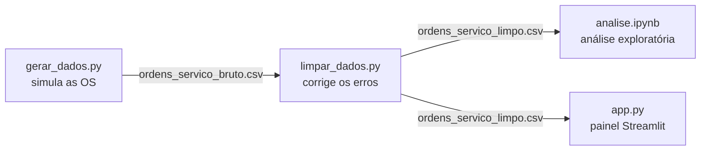
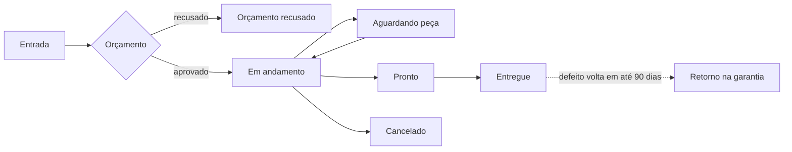

# Painel de BI — Assistência Técnica de Celulares

Solução de Business Intelligence desenvolvida para a **Opção Telefonia Celular**, assistência
técnica e loja de celulares em **Bauru (SP)**. O painel transforma as ordens de serviço da loja
em indicadores, gráficos, previsões e recomendações que ajudam o dono a decidir onde melhorar:
estoque, equipe, preços, divulgação e qualidade dos reparos.

> **Aviso:** os dados usados neste projeto são **simulados** com base em informações passadas
> pela empresa. Eles não são os dados reais da assistência (veja a [seção 2](#2-problema-e-seleção-dos-dados)).

**Ferramentas:** Python · pandas · NumPy · Plotly · Streamlit · Jupyter · GitHub

---

## Sumário

- [Como rodar](#como-rodar)
- [Visão geral do sistema](#visão-geral-do-sistema)
- [1. Empresa e necessidade](#1-empresa-e-necessidade)
- [2. Problema e seleção dos dados](#2-problema-e-seleção-dos-dados)
- [3. Limpeza, tratamento e exploração](#3-limpeza-tratamento-e-exploração)
- [4. Painel interativo](#4-painel-interativo)
- [5. Insights para a tomada de decisão](#5-insights-para-a-tomada-de-decisão)
- [6. Usabilidade e clareza](#6-usabilidade-e-clareza)
- [Desafios e decisões do projeto](#desafios-e-decisões-do-projeto)
- [Limitações e próximos passos](#limitações-e-próximos-passos)
- [Grupo](#grupo)

---

## Como rodar

Pré-requisito: Python 3.10 ou superior.

```bash
pip install -r requirements.txt   # instala as bibliotecas
python gerar_dados.py             # cria dados/ordens_servico_bruto.csv
python limpar_dados.py            # cria dados/ordens_servico_limpo.csv e mostra o relatório
streamlit run app.py              # abre o painel em http://localhost:8501
```

Os dois CSVs já estão no repositório, então dá para rodar direto o `streamlit run app.py`.
Para ver a análise exploratória, abra o `analise.ipynb` no Jupyter ou no VS Code.

---

## Visão geral do sistema

O projeto é um **pipeline de dados** em quatro etapas. Cada etapa é um arquivo e entrega um
resultado para a próxima:



| Etapa | Arquivo | Entrada | Saída |
|---|---|---|---|
| 1. Coleta (simulada) | `gerar_dados.py` | Parâmetros informados pelo dono + preços de mercado | `dados/ordens_servico_bruto.csv` (2.549 linhas, com erros) |
| 2. Limpeza | `limpar_dados.py` | Base bruta | `dados/ordens_servico_limpo.csv` (2.519 linhas) + relatório |
| 3. Exploração | `analise.ipynb` | Base limpa | Gráficos e 5 conclusões |
| 4. Visualização | `app.py` | Base limpa | Painel interativo com filtros, 10 indicadores, 11 gráficos, previsão e insights |

### Estrutura de pastas

```
├── README.md                  # este documento
├── requirements.txt           # bibliotecas usadas
├── gerar_dados.py             # etapa 1: cria a base simulada
├── limpar_dados.py            # etapa 2: limpa a base
├── analise.ipynb              # etapa 3: análise exploratória
├── app.py                     # etapa 4: painel Streamlit
├── .streamlit/config.toml     # tema visual do painel
├── assets/logo.jpg            # logo da empresa (topo do painel e ícone da aba)
├── dados/
│   ├── ordens_servico_bruto.csv
│   └── ordens_servico_limpo.csv
└── docs/
    └── entrega1.md            # documento da Entrega 1
```

---

## 1. Empresa e necessidade

> *Objetivo: identificar uma empresa real e compreender uma necessidade que possa ser apoiada por BI.*

| | |
|---|---|
| **Empresa** | Opção Telefonia Celular |
| **O que faz** | Assistência técnica (conserto) e venda de celulares |
| **Onde fica** | Bauru (SP) |
| **Responsável** | Felipe Campos Guimarães, dono da empresa e técnico |
| **Equipe técnica** | 2 técnicos: Felipe Campos e Carlos Eduardo |

### Como a loja funciona

Cada celular que chega para conserto gera uma **ordem de serviço (OS)**. A OS passa por estas etapas:



### A necessidade

Em conversa com o dono, levantamos os indicadores que ele quer acompanhar: **aparelhos recebidos
e entregues, serviços em andamento, tempo médio de reparo, taxa de conclusão, defeitos mais
frequentes, taxa de retorno por problema e receita por tipo de reparo**. Ele também pediu dados
dos aparelhos (marca e modelo) e dos clientes (se são recorrentes).

Hoje ele **não tem uma visão clara** desses números. Decisões como "quanto estoque de tela
manter", "quando reforçar a equipe" ou "onde divulgar a loja" são tomadas no feeling.

---

## 2. Problema e seleção dos dados

> *Objetivo: definir o problema e escolher dados relacionados à necessidade.*

### O problema

**Como transformar o histórico de ordens de serviço em informação para o dono decidir onde
melhorar?** A resposta é um painel simples, que ele pode abrir e filtrar sozinho.

### Por que dados simulados

A empresa não liberou os dados reais das ordens de serviço. Por isso, criamos uma **base simulada
que imita o comportamento da loja**, usando números passados pelo dono (volume diário, marcas
atendidas, defeitos mais comuns, preços e prazos) e preços de peças pesquisados em lojas online.
O painel fica pronto para receber os dados reais no futuro: basta trocar o CSV.

### Dicionário de dados

Uma linha por OS, 12 meses de dados (01/11/2025 a 17/10/2026), separador `;`.

| Coluna | Descrição | Exemplo |
|---|---|---|
| `os_id` | Número da OS | `OS-0001` |
| `data_entrada` | Quando o aparelho chegou | `2026-03-10` |
| `data_conclusao` | Quando o reparo terminou (vazio se não terminou) | `2026-03-12` |
| `data_entrega` | Quando o cliente retirou (vazio se não retirou) | `2026-03-13` |
| `cliente_id` | Código anônimo do cliente (sem nome, telefone ou CPF) | `CLI-0001` |
| `origem_cliente` | Como o cliente conheceu a loja | `Indicação` |
| `marca` | Samsung, Apple, Motorola, Xiaomi, Realme, LG ou Asus | `Samsung` |
| `modelo` | Modelo do aparelho (173 modelos diferentes) | `Galaxy A54` |
| `defeito` | Problema relatado | `Tela quebrada` |
| `tipo_reparo` | Serviço feito | `Troca de tela` |
| `tecnico` | Quem consertou | `Felipe Campos` |
| `status` | Orçamento recusado, Em andamento, Aguardando peça, Pronto, Entregue ou Cancelado | `Entregue` |
| `valor` | Valor cobrado (ou orçado, se recusado) em R$ | `350.00` |
| `custo_peca` | Custo da peça usada em R$ | `175.00` |
| `retorno_garantia` | Voltou com defeito em até 90 dias? (só para entregues) | `Sim` / `Não` |

Colunas criadas na limpeza: `dias_reparo` (dias entre entrada e conclusão), `mes` (ex.: `2026-03`),
`dia_semana` (ex.: `Segunda`) e `lucro` (`valor` − `custo_peca`).

---

## 3. Limpeza, tratamento e exploração

> *Objetivo: pré-processar (limpar, transformar, organizar) e explorar os dados.*

### 3.1 Geração da base — `gerar_dados.py`

O script usa `numpy` para sortear os dados e `pandas` para montar a tabela.
`np.random.seed(42)` garante que a base saia **sempre igual**, então qualquer pessoa que rodar o
script chega nos mesmos números. Todos os parâmetros ficam **em variáveis no topo do script**:
se o dono passar números diferentes, é só ajustar ali.

| Parâmetro | Valor usado |
|---|---|
| Volume | ~8 aparelhos/dia, sem domingos; dezembro e janeiro com 30% a mais |
| Dia da semana | Segunda (+15%) e sábado (+5%) mais cheios; terça e quarta mais calmas (−10%) |
| Marcas | Samsung 37% · Apple 27% · Motorola 19% · Xiaomi 11% · Realme 3% · LG 2% · Asus 1% |
| Modelos | **173 modelos** vendidos no Brasil entre 2017 e 2024, dos básicos (Galaxy A01, Moto E7, Redmi 9A) aos premium (Galaxy Z Fold5, iPhone 16 Pro) |
| Popularidade dos modelos | Peso = 1 ÷ posição^0,8: poucos modelos muito comuns (Galaxy A14, iPhone 11, Moto G54) e muitos raros |
| Preço Apple | ~50% mais caro que as outras marcas |
| Preço premium | Modelos topo de linha (Pro, Ultra, Galaxy S/Note/Z, Edge, Razr, Xiaomi 1x, Poco F...) ~40% mais caros |
| Técnicos | Felipe Campos e Carlos Eduardo, com a mesma chance de retorno |
| Espera de peça | 15% das trocas de tela e reparos de placa ganham +3 a 7 dias |
| Retirada demorada | 4% dos clientes demoram 30 a 150 dias para buscar o aparelho |
| Cancelamentos | ~5% das OS aprovadas (valor 0) |
| Clientes | 25% das OS são de clientes que já vieram antes |
| Origem dos clientes | Indicação 35% · Instagram 25% · Passou na frente 20% · Google 15% · Outros 5% |

| Defeito | Tipo de reparo | Chance | Preço (R$) | Dias | Retorno | Custo da peça (% do preço) | Orçamento recusado |
|---|---|---|---|---|---|---|---|
| Tela quebrada | Troca de tela | 35% | 250–700 | 1–3 | 5% | 40–60% | 8% |
| Bateria viciada | Troca de bateria | 20% | 120–280 | 1–2 | 4% | 30–45% | 5% |
| Conector de carga | Troca de conector | 15% | 90–190 | 1–2 | 8% | 15–30% | 5% |
| Não liga | Reparo de placa | 10% | 200–600 | 3–8 | 15% | 10–30% | 30% |
| Danos por água | Limpeza de oxidação | 10% | 150–380 | 3–7 | 25% | 5–15% | 25% |
| Software travando | Reinstalação de software | 10% | 60–140 | 0–1 | 10% | 0% | 5% |

**Custo da peça:** definido como uma fração do preço cobrado, com base em preços de peças
paralelas em lojas online. A tela é a peça mais cara (até 60% do preço). Uma placa de conector
custa de R$ 20 a R$ 50, e software e oxidação quase não usam peça.

**Como o script funciona, passo a passo:**

1. **Datas de entrada:** para cada dia do período (menos domingos), sorteia quantos aparelhos
   chegaram com `np.random.poisson(média × peso do dia da semana)`. A distribuição de Poisson é
   usada para contagens.
2. **Sorteios:** marca, modelo, defeito e técnico são sorteados com `np.random.choice`,
   respeitando as chances. Os modelos de cada marca estão em ordem de popularidade, e o peso de
   cada um é `1 ÷ posição^0,8`. Assim, o 1º modelo aparece bem mais que o 10º, mas mesmo os
   modelos raros aparecem algumas vezes, como numa assistência de verdade.
3. **Clientes:** cada OS tem 25% de chance de ser de um cliente antigo (um código já sorteado).
   Se for cliente novo, ganha um código novo e uma origem. A origem fica guardada e é a mesma
   em todas as visitas.
4. **Cada OS:** calcula o preço (com acréscimo para Apple e modelos premium), o custo da peça, os dias de reparo (às vezes com espera de
   peça), os dias até a retirada (às vezes bem demorada) e as datas.
5. **Status:** primeiro sorteia se o orçamento foi recusado e depois se foi cancelado. Em
   seguida compara as datas com o "hoje" da base (17/10/2026):
   - conserto ainda não terminado → `Em andamento` ou `Aguardando peça`;
   - terminado, mas não retirado → `Pronto`;
   - retirado → `Entregue`.
6. **Retorno na garantia:** sorteado só para OS entregues, com a chance do defeito.
7. **Erros de propósito:** a base é "suja" antes de salvar, para simular problemas reais de digitação:

| Erro inserido | Quantidade | Exemplo |
|---|---|---|
| Datas no formato brasileiro | ~10% de cada coluna de data | `03/06/2026` em vez de `2026-06-03` |
| Marcas escritas errado | ~8% | `samsung`, `SAMSUNG`, `Sansung`, `apple`, `iPhone`, `moto`, `XIAOMI`, `realme`, `lg`, `ASUS` |
| Valores como texto | ~10% | `R$ 350,00` em vez de `350.00` |
| Técnico vazio | ~3% | campo em branco |
| Linhas duplicadas | 30 | mesma OS digitada duas vezes |

### 3.2 Limpeza — `limpar_dados.py`

Cada problema é corrigido por **uma função pequena**. Todas seguem o mesmo padrão: recebem a
tabela e devolvem `(tabela corrigida, quantidade de linhas corrigidas)`. Isso permite montar o
relatório no final.

| Função | O que faz | Como faz |
|---|---|---|
| `remover_duplicadas` | Remove linhas repetidas | `df.drop_duplicates()` |
| `corrigir_datas` | Converte as 3 colunas de data | Tenta ler como `AAAA-MM-DD`; o que falhar, tenta como `DD/MM/AAAA` |
| `padronizar_marcas` | Unifica a escrita das marcas | Tira espaços, passa para minúsculas e aplica um dicionário de correções (`sansung` → Samsung, `iphone` → Apple, `moto` → Motorola) |
| `converter_valores` | Transforma texto em número | Remove `R$`, troca vírgula por ponto e converte `valor` e `custo_peca` para `float` |
| `preencher_tecnico` | Trata técnico vazio | Preenche com `Não informado` (não inventa quem fez o reparo) |
| `criar_colunas` | Cria colunas úteis para a análise | `dias_reparo`, `mes`, `dia_semana` e `lucro` |

A base bruta é lida com `dtype=str` (tudo como texto), para que o pandas não tente adivinhar os
tipos e cada função trate sua coluna do jeito certo.

**Relatório gerado ao rodar `python limpar_dados.py`:**

```
=== Relatório de limpeza ===
Linhas na base bruta:          2549
Duplicadas removidas:          30
Linhas com data DD/MM/AAAA:    629
Marcas padronizadas:           192
Valores em texto convertidos:  259
Técnicos vazios preenchidos:   64
Colunas criadas:               dias_reparo, mes, dia_semana, lucro
Linhas na base limpa:          2519
```

Depois da limpeza: nenhuma duplicada, todas as marcas dentro da lista oficial, `valor` e
`custo_peca` numéricos e nenhuma data perdida (só ficam vazias as datas que ainda não aconteceram).

### 3.3 Análise exploratória — `analise.ipynb`

O notebook usa a base limpa e tem uma seção por pergunta. Cada seção tem um gráfico Plotly e
um texto curto explicando o que ele mostra.

| Seção | Pergunta | O que encontramos |
|---|---|---|
| 1. Visão geral | Como é a base? | 2.519 OS de 1.912 clientes, 7 marcas e 173 modelos; 83% entregues, 10% com orçamento recusado |
| 2. Volume | Existe época de pico? Qual o dia mais cheio? | Dez/jan têm ~38% mais entradas; segunda e sábado são os dias mais cheios |
| 3. Defeitos e modelos | Qual o problema mais comum? Quais telas estocar? | Tela quebrada (35,9%); iPhone 11, Galaxy A14 e Moto G54 lideram as telas quebradas |
| 4. Tempo de reparo | Qual serviço demora mais? | Reparo de placa (5,9 dias em média) |
| 5. Retorno na garantia | O que mais volta? | Danos por água (27,3% de retorno) |
| 6. Receita e lucro | O que dá mais dinheiro? E mais lucro? | Troca de tela: 58,0% da receita, mas a menor margem (50%) |
| 7. Orçamentos | O que o cliente mais recusa? | Placa e oxidação (~27% recusados) |
| 8. Clientes | Os clientes voltam? Como chegam? | 24% voltam; indicação traz 35% dos novos |
| 9. Conclusões | — | 5 descobertas **calculadas pelo código** (se os dados mudarem, o texto muda junto) |

---

## 4. Painel interativo

> *Objetivo: criar visualizações e relatórios que permitam explorar os dados de forma clara e interativa.*

O painel é um único arquivo, `app.py`, feito com **Streamlit** (gera a página web a partir de
Python) e **Plotly** (gráficos interativos, com zoom e valores ao passar o mouse).

### Layout

O desenho segue a skill **dashboard-designer** (boas práticas de dashboards de BI): layout em
**"F"**, porque o olho lê do canto superior esquerdo para a direita e depois desce. O mais
importante fica no topo e os detalhes ficam embaixo. **Não há abas**: tudo fica visível rolando a
página, em seções.

```
┌──────────────────────────────────────────────────────────────────────────┐
│ [logo] Opção Celular · Painel da Assistência                              │
│ [Período ▼ Últimos 30 dias] [Técnico ▼] [Marca ▼] [Modelo ▼ buscar...]    │ ← filtros no topo
├──────────────┬─────────────┬─────────────┬──────────────┬────────────────┤
│ Receita      │ Lucro bruto │ Recebidos   │ Tempo médio  │ Taxa retorno   │ ← nível 1: 5 KPIs
│ R$ 55,7 mil  │ R$ 33,8 mil │ 199         │ 2,4 dias     │ 6,8%           │   grandes
├──────────────┴─────────────┴─────────────┴──────────────┴────────────────┤
│ Em andamento · Conclusão · Orçamentos aprovados · Clientes que voltaram   │ ← nível 2: apoio
├────────────────────────────────────────────┬─────────────────────────────┤
│ Gráfico principal: recebidos × entregues    │ Insights                    │ ← tendência +
│ por mês + previsão tracejada                │ (frases com recomendação)   │   insights
├────────────────────────────────────────────┴─────────────────────────────┤
│ Serviços e qualidade (4 gráficos) · Financeiro (4) · Clientes (2)         │ ← nível 3: detalhe
└──────────────────────────────────────────────────────────────────────────┘
```

| Princípio da skill | Como foi aplicado |
|---|---|
| 3 a 5 KPIs principais em destaque | 5 cartões grandes no topo; os demais ficam numa faixa menor logo abaixo |
| Filtros no topo, padrão na visão mais comum | Filtros numa faixa no topo; padrão = **últimos 30 dias** (o dono acompanha o mês) |
| Títulos como insight, não rótulo | "Danos por água volta 3,3× mais que a média" em vez de "Taxa de retorno por defeito" |
| Cinza como padrão, cor só para destacar | Barras cinza; azul = destaque, laranja = atenção, vermelho = problema |
| Paleta segura para daltônicos | `#0077BB`, `#EE7733`, `#009988`, `#CC3311` + cinza `#BBBBBB` |
| Máx. 5 fatias em pizza → barras ranqueadas | A pizza de origem virou barras ordenadas |
| Números arredondados | `R$ 751,9 mil` nos cartões e gráficos, em vez de `R$ 751.943,98` |
| Mostrar tendência, não só o retrato | Gráficos de tendência sempre com os últimos 12 meses; o período escolhido aparece sombreado |

### Como o código funciona, bloco a bloco

**1. Carregamento com cache.** A função `carregar_dados()` lê o CSV limpo, converte as datas e
marca se cada OS é de um **cliente que voltou** (`cumcount() > 0` por cliente: já tinha outra OS
antes). O decorador `@st.cache_data` guarda o resultado na memória: o Streamlit roda o script
inteiro a cada clique, mas o arquivo só é lido uma vez.

**2. Filtros no topo.**
- **Período** (`st.selectbox`): últimos 30 dias (padrão), 3 meses, 6 meses, 12 meses ou personalizado
  (abre um `st.date_input` com as datas).
- **Técnico**, **Marca** e **Modelo** (`st.multiselect`): deixar vazio significa "todos".
- A lista de **modelos depende da marca**: escolhendo Apple, só aparecem os 31 iPhones. Dá para
  digitar para buscar entre os 173 modelos. Se a marca mudar, os modelos que não pertencem a ela
  saem da seleção sozinhos.
- Se o filtro não tiver nenhuma OS, o painel avisa e para (`st.stop()`), em vez de mostrar gráficos vazios.

**3. Indicadores.** A função `calcular_indicadores(base, inicio, fim)` calcula todos os
indicadores do período escolhido e devolve um dicionário usado pelos cartões. Os cartões mostram
só o título e o número, sem informação extra, para a leitura ficar rápida.

| Indicador | Cálculo | Data usada |
|---|---|---|
| Aparelhos recebidos | Quantidade de OS | Entrada |
| Aparelhos entregues | OS com status `Entregue` | Entrega |
| Em andamento (hoje) | OS `Em andamento` ou `Aguardando peça` | Situação atual |
| Tempo médio de reparo | Média de `dias_reparo` | Entrada |
| Orçamentos aprovados | 1 − (orçamentos recusados ÷ recebidos) | Entrada |
| Taxa de conclusão | (Pronto + Entregue) ÷ (recebidas − recusadas − em andamento) | Entrada |
| Taxa de retorno | Retornos na garantia ÷ entregues | Entrega |
| OS de clientes que voltaram | OS de clientes que já tinham vindo antes ÷ recebidas | Entrada |
| Receita total | Soma de `valor` das entregues | Entrega |
| Lucro bruto | Soma de `lucro` (receita − custo das peças) das entregues | Entrega |
| Margem | Lucro ÷ receita | Entrega |
| Ticket médio | Receita ÷ entregues | Entrega |

A receita conta pela **data de entrega**, porque é quando o cliente paga. Um aparelho que
entrou em setembro e foi retirado em outubro entra na receita de outubro.

**4. Previsão de demanda (análise preditiva).** A função `prever_demanda()` usa um método
**sazonal simples**, fácil de explicar:

```
previsão do mês = aparelhos no mesmo mês do ano anterior × ritmo recente
ritmo recente   = média dos últimos 3 meses completos ÷ média de todos os meses completos
```

O mês atual fica fora, porque ainda não terminou. O método reaproveita a sazonalidade, como o pico
de dezembro e janeiro, e ajusta pelo momento atual da loja (ritmo de 0,96 = loja 4% abaixo da média).
O resultado é a previsão dos próximos 3 meses, desenhada em linha tracejada depois do histórico.

**5. Formatação brasileira.** Funções pequenas (`formatar_numero`, `formatar_reais`,
`formatar_percentual`, `nome_mes`) mostram os números como `R$ 1.234,56`, `12,5%` e `março/2026`.

**6. Meta de tempo.** A constante `META_TEMPO` (3 dias) no topo do `app.py` aparece como linha
tracejada no gráfico de tempo de reparo. Os reparos acima dela ficam em laranja. Deve ser ajustada
com o Felipe.

**7. Gráficos com destaque.** Quase todos os gráficos de barras usam uma única função, `barras()`:
- pinta tudo de cinza e só o que importa em cor (o maior item, o que está acima da média ou da meta);
- coloca o título como conclusão e um subtítulo com a medida;
- pode desenhar uma linha tracejada de média ou meta.

Os títulos são **calculados**: se o filtro mudar, o título muda junto.

| Seção | Gráficos | Pergunta que responde |
|---|---|---|
| **Topo** | Recebidos × entregues por mês + **previsão** tracejada · "Insights" | O movimento está crescendo? O que vem pela frente? |
| **Serviços e qualidade** | Defeitos · Retorno por defeito (vermelho = acima da média) · Tempo por reparo (laranja = acima da meta) · **10 modelos mais consertados** | O que mais chega? O que volta? O que demora? Quais peças estocar? |
| **Financeiro** | Receita por tipo · **Margem** por tipo (laranja = abaixo da média) · Receita e lucro por mês · **Orçamentos recusados** por tipo | O que dá mais dinheiro? E mais lucro? Onde perdemos orçamentos? |
| **Clientes** | **Como os clientes novos conheceram a loja** · Clientes novos × que voltaram por mês | Qual canal de divulgação funciona? Os clientes voltam? |

**8. Visual.** O tema claro fica no `.streamlit/config.toml`: fundo branco e azul `#0077BB` como cor
principal. As cores ficam em constantes no topo do `app.py` (`AZUL`, `CINZA`, `LARANJA`,
`VERMELHO`, `VERDE`). Um pequeno CSS deixa os números dos 5 cartões principais maiores que os da
faixa de apoio, reforçando a hierarquia.

---

## 5. Insights para a tomada de decisão

> *Objetivo: apresentar informações que contribuam para decisões, com análises descritivas, diagnósticas, preditivas ou prescritivas.*

O projeto cobre os **quatro tipos de análise**:

| Tipo | O que responde | Onde aparece |
|---|---|---|
| **Descritiva** | *O que aconteceu?* | Cartões, volume por mês, defeitos, modelos, receita, clientes |
| **Diagnóstica** | *Por que aconteceu?* | Retorno por defeito/técnico vs. média; tempo vs. meta; margem por tipo; recusa por tipo |
| **Preditiva** | *O que vai acontecer?* | Previsão de aparelhos recebidos nos próximos 3 meses |
| **Prescritiva** | *O que fazer?* | Cada insight termina com uma recomendação (→) |

### Insights automáticos

Ao lado do gráfico principal, no quadro **"Insights"**, o painel escreve até 5 frases
**calculadas na hora** a partir dos dados filtrados. Nenhum número fica fixo no texto: se o dono
filtrar só Apple ou só setembro, as frases mudam.

| # | O que o código calcula | Exemplo (últimos 12 meses) | Recomendação |
|---|---|---|---|
| 1 | Tipo de reparo com maior fatia da receita e a margem dele | Troca de tela = **58,0%** da receita, margem **50,1%** | Negociar a peça com fornecedores e estocar os modelos mais comuns |
| 2 | Defeito com maior taxa de retorno ÷ média geral | Danos por água volta em **27,3%**, **3,4×** a média | Revisar o procedimento ou o prazo de garantia |
| 3 | Tipo de reparo com mais orçamentos recusados | Limpeza de oxidação: **27,8%** recusados; R$ 99,6 mil não fecharam | Revisar o preço ou oferecer parcelamento |
| 4 | Principal origem dos clientes novos | Indicação trouxe **35,3%** dos clientes novos | Investir no canal (ex.: desconto para quem indica) |
| 5 | Mês de maior movimento na previsão | Janeiro/2027: **273 aparelhos** (média recente: 209) | Planejar estoque e equipe com antecedência |

Uma regra evita conclusões erradas:
- **Mínimo de 30 OS:** com poucos dados, uma única OS vira "100% da receita". Abaixo desse
  número, os insights não aparecem.

### Principais descobertas (dados completos)

1. **Tela quebrada é o carro-chefe, mas com a menor margem:** 58,0% da receita e margem de 50,1%.
2. **Dezembro e janeiro são o pico:** ~38% mais aparelhos; a previsão repete o pico em dez/2026 e jan/2027.
3. **Danos por água volta muito:** 27,3% de retorno, contra 8,1% na média geral.
4. **Placa e oxidação perdem orçamentos:** ~27% recusados; R$ 99,6 mil em orçamentos não fecharam.
5. **Indicação é o melhor canal:** 35% dos clientes novos, e 24% dos clientes voltam.

---

## 6. Usabilidade e clareza

> *Objetivo: solução intuitiva, organizada e adequada ao público que vai usar.*

O público do painel é o **dono da loja**, que não é da área de dados. Por isso:

- **Tudo em português**, com termos do dia a dia da loja (aparelhos, orçamento, garantia).
- **Números no formato brasileiro:** `R$ 751.943,98` e `8,1%`.
- **Do geral para o detalhe (layout em F):** 5 números principais grandes, depois uma faixa de
  apoio, o gráfico principal com os insights ao lado e por fim as seções de detalhe.
- **Nada escondido em abas:** tudo aparece rolando a página, em seções com título.
- **Cartões limpos:** só título e número, sem informação extra.
- **Títulos que dizem a conclusão** ("Tela quebrada é 36,9% dos defeitos") e subtítulo com a medida.
- **Cor só onde importa:** barras cinza, com destaque em azul, laranja ou vermelho; paleta segura para daltônicos.
- **Linha da média ou da meta** nos gráficos, para ver na hora quem está acima.
- **Insights em frases com recomendação:** o dono não precisa interpretar o gráfico sozinho.
- **Visual limpo de BI:** fundo branco, cartões com borda, sem botões de desenvolvedor.
- **Privacidade (LGPD):** clientes aparecem só como código (`CLI-0001`), sem nome, telefone ou CPF.

---

## Desafios e decisões do projeto

| Desafio | Como resolvemos |
|---|---|
| A empresa não liberou os dados reais | Base simulada com os números informados pelo dono e preços de peças de lojas online, com parâmetros fáceis de ajustar |
| Tornar a limpeza realista | A base é gerada com erros comuns de digitação, para a limpeza ter o que corrigir |
| Datas em dois formatos na mesma coluna | Leitura em duas tentativas (`AAAA-MM-DD` e depois `DD/MM/AAAA`) |
| Indicadores contados pela data certa | Recebidos pela data de entrada; entregues, receita e lucro pela data de entrega |
| Previsão que o dono entenda | Método sazonal simples (mesmo mês do ano anterior × ritmo recente), fácil de explicar na apresentação |
| Dados de clientes x privacidade | Clientes anônimos (código), sem nome, telefone ou CPF, mesmo o dono tendo esses dados |
| Insights que não enganam com poucos dados | Mínimo de 30 OS para gerar os insights |
| Painel confuso, com informação escondida em abas | Redesenho com a skill dashboard-designer: layout em F, 5 KPIs principais, títulos como conclusão, cor só para destacar e seções sem abas |
| Dados simulados com pessoas reais | Os técnicos reais têm a mesma chance de retorno: o painel não inventa diferença de desempenho |
| Painel mostrando dados antigos | O `@st.cache_data` guarda os dados na memória; ao trocar o CSV, é preciso limpar o cache (menu ⋮ → *Clear cache*) ou reiniciar o painel |

---

## Limitações e próximos passos

- **Dados simulados:** os números refletem as informações do dono, não o histórico real. O
  próximo passo é carregar os dados reais da loja. O painel funciona com qualquer CSV no mesmo formato.
- **Previsão com um ano de histórico:** o método sazonal precisa do mesmo mês no ano anterior.
  Com mais anos de dados, dá para usar modelos mais robustos, como média de vários anos ou regressão.
- **Custo da peça estimado:** usamos faixas de preço de mercado. Com as notas de compra reais, o
  lucro por serviço fica exato.
- **Custos fixos:** o lucro bruto não desconta aluguel, salários e contas. Com esses valores, dá
  para calcular o lucro líquido e o ponto de equilíbrio.

---

## Grupo

- Cherlau
- João
