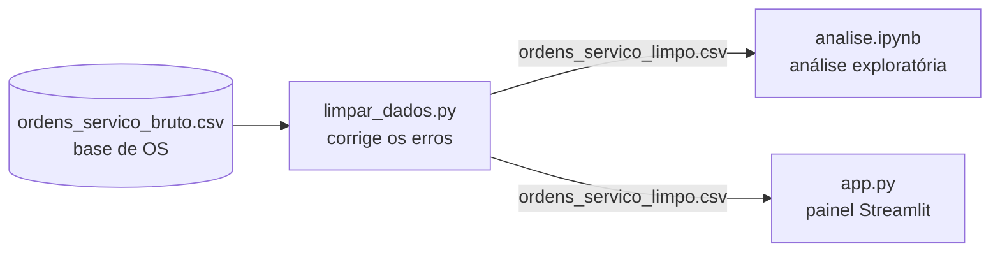

# Painel de BI — Assistência Técnica de Celulares

Painel de Business Intelligence feito para a **Opção Telefonia Celular**, assistência técnica e loja
de celulares em **Bauru (SP)**. Ele mostra quantos aparelhos entram e saem, quanto tempo os reparos
levam, quais defeitos são mais comuns, o que volta na garantia e quais serviços dão mais dinheiro,
para ajudar o dono a decidir onde melhorar.

> **Aviso:** os dados são **simulados** com base em informações passadas pela empresa. Eles não são
> os dados reais da assistência.

**Ferramentas:** Python · pandas · NumPy · Plotly · Streamlit · Jupyter · GitHub

## Como rodar

```bash
pip install -r requirements.txt   # instala as bibliotecas
python limpar_dados.py            # limpa a base e mostra o relatório
streamlit run app.py              # abre o painel em http://localhost:8501
```

A base limpa já está no repositório, então dá para rodar direto o `streamlit run app.py`.
A análise exploratória está no `analise.ipynb`.

## Estrutura

```
├── dados/
│   ├── ordens_servico_bruto.csv   # base de ordens de serviço (com erros de digitação)
│   └── ordens_servico_limpo.csv   # base limpa
├── limpar_dados.py                # limpeza dos dados
├── analise.ipynb                  # análise exploratória
├── app.py                         # painel Streamlit
├── assets/logo.jpg                # logo da empresa
└── .streamlit/config.toml         # tema visual do painel
```

## Fluxo dos dados



| Etapa | Arquivo | Entrada | Saída |
|---|---|---|---|
| 1. Dados | `dados/ordens_servico_bruto.csv` | — | Base de OS com 2.549 linhas, com erros de digitação |
| 2. Limpeza | `limpar_dados.py` | Base bruta | `dados/ordens_servico_limpo.csv` (2.519 linhas) + relatório |
| 3. Exploração | `analise.ipynb` | Base limpa | Gráficos e 5 conclusões |
| 4. Visualização | `app.py` | Base limpa | Painel interativo com filtros, indicadores, gráficos, previsão e insights |

## A empresa e o problema

- **Empresa:** Opção Telefonia Celular, conserto e venda de celulares, em Bauru (SP).
- **Responsável:** Felipe Campos Guimarães, dono e técnico. A equipe técnica é formada por Felipe
  Campos e Carlos Eduardo.
- **Problema:** cada aparelho que chega gera uma **ordem de serviço (OS)**, mas o dono não tem uma
  visão clara desses números. Ele pediu para acompanhar aparelhos recebidos e entregues, serviços em
  andamento, tempo médio de reparo, taxa de conclusão, defeitos mais frequentes, taxa de retorno por
  problema e receita por tipo de reparo.

## Os dados

Uma linha por ordem de serviço, de 01/11/2025 a 17/10/2026: cerca de 2.500 OS, 7 marcas e 173 modelos.
As principais colunas são:
- datas de entrada, conclusão e entrega;
- cliente, identificado só por um código anônimo;
- origem do cliente;
- marca, modelo, defeito e tipo de reparo;
- técnico e status;
- valor cobrado e custo da peça;
- se o aparelho voltou na garantia.

## Como funciona

1. **Limpeza (`limpar_dados.py`):** a base bruta tem erros comuns de digitação. Cada tipo de erro é
   corrigido por uma função pequena, e no final o script mostra um relatório:

   | Problema | Correção | Linhas |
   |---|---|---|
   | Linhas duplicadas | Removidas | 30 |
   | Datas em dois formatos (`2026-06-03` e `03/06/2026`) | Padronizadas | 629 |
   | Marcas escritas errado (`Sansung`, `moto`, `iPhone`...) | Padronizadas | 192 |
   | Valores em texto (`R$ 350,00`) | Convertidos para número | 259 |
   | Técnico vazio | Preenchido com "Não informado" | 64 |

   A limpeza também cria as colunas `dias_reparo`, `mes`, `dia_semana` e `lucro`.

2. **Análise exploratória (`analise.ipynb`):** gráficos sobre volume por mês, defeitos, tempo de
   reparo, retorno na garantia, receita, orçamentos e clientes. As conclusões são calculadas a
   partir dos dados.

3. **Painel (`app.py`):** feito com Streamlit e Plotly.
   - **Filtros:** período (padrão: últimos 30 dias), técnico, marca e modelo.
   - **Indicadores:** receita, lucro bruto, aparelhos recebidos, tempo médio de reparo, taxa de
     retorno, serviços em andamento, taxa de conclusão, orçamentos aprovados e clientes que voltaram.
   - **Gráfico principal:** aparelhos recebidos e entregues por mês, com a **previsão** dos próximos 3
     meses (mesmo mês do ano anterior × ritmo recente da loja).
   - **Insights:** frases calculadas na hora, cada uma com uma recomendação.
   - **Seções:** Serviços e qualidade, Financeiro e Clientes. Os títulos dos gráficos já dizem a
     conclusão, e a cor destaca só o que importa.

## Principais descobertas

1. **Troca de tela é o carro-chefe:** 58% da receita, mas com a menor margem (50%).
2. **Dezembro e janeiro são o pico:** cerca de 38% mais aparelhos que nos outros meses.
3. **Danos por água volta muito:** 27% de retorno na garantia, contra 8% na média.
4. **Placa e oxidação perdem orçamentos:** cerca de 27% são recusados.
5. **Indicação é o melhor canal:** traz 35% dos clientes novos, e 24% dos clientes voltam.

## Grupo

- Cherlau
- João
